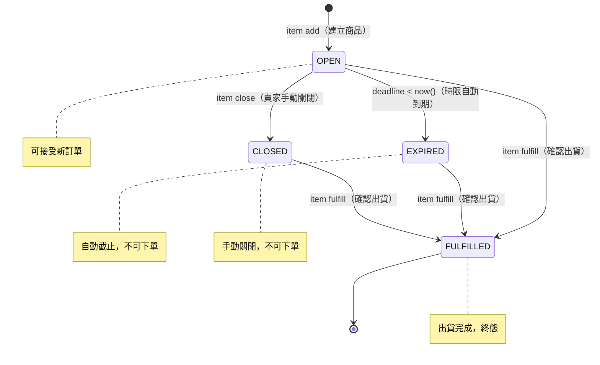
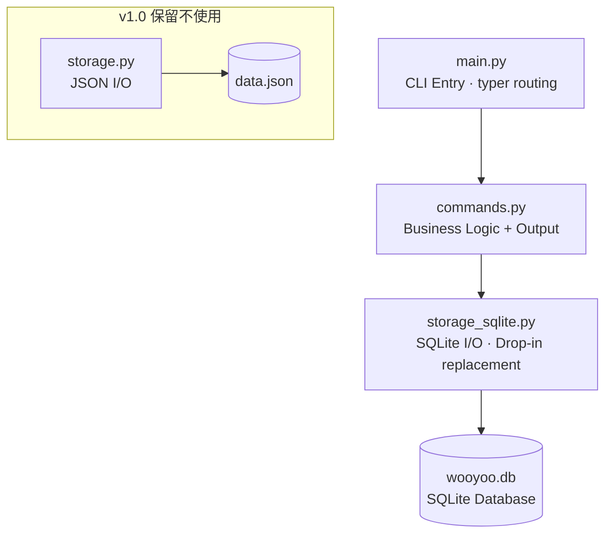
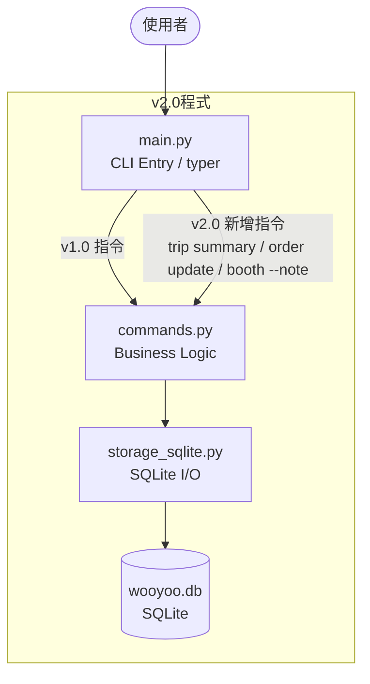
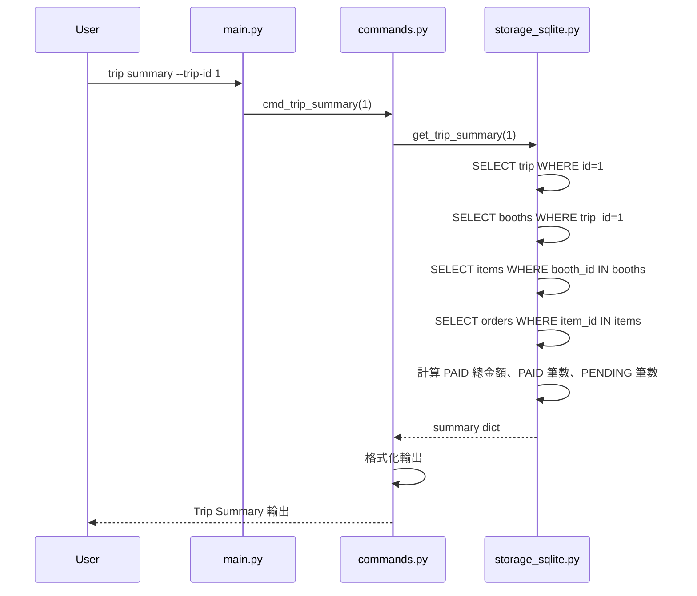

# Wooyoo.Studio v2.0 — Spec-Driven Development Document (SDD)

---

## 1. 專案概覽（Project Overview）

- **程式名稱**：Wooyoo.Studio
- **版本**：v2.0
- **一句話描述（Elevator Pitch）**：

  > *"The live shopping experience your buyers deserve, and the control your business needs."*
  >
  > 韓國代購的交易流程高度依賴 LINE 群組，但群組訊息混亂、價格不透明、每筆訂單都要手動加好友、對帳、收匯款資訊，既耗時又容易出錯。
  >
  > Wooyoo.Studio 是專為即時代購設計的交易管理工具，賣家可以在現場快速上架商品、設定接單時限與公開價格；買家可以直接下單並完成付款確認，不需要額外的私訊往來；每個品牌攤位可附加備註，方便記錄規則或特殊注意事項；訂單數量可隨時調整，庫存自動同步；跑完一趟行程後，賣家只需一個指令即可跨越所有攤位與商品，即時彙整收款總覽，清楚掌握哪些款項已收、哪些仍在等待確認。

- **目標使用者**：小規模韓國代購賣家（無自架平台能力、主要透過 LINE 群組經營）及其買家群。
- **核心價值**：用結構化的交易流程取代混亂的群組溝通，讓賣家專注於選品、讓買家安心下單；並以穩定的資料儲存與即時收款總覽，讓賣家在代購現場掌握每一筆交易的進度與收款狀況。

---

## 2. CLI 介面規格（Interface Specification）

程式進入點：`python main.py <group> <command> [options]`

### `trip`（代購行程）

| 指令 | 參數 | 說明 | 範例 |
|---|---|---|---|
| `trip create` | `--name TEXT` `--dest TEXT` | 建立新代購行程 | `python main.py trip create --name "首爾春季" --dest "首爾"` |
| `trip list` | 無 | 列出所有行程 | `python main.py trip list` |
| `trip summary` | `--trip-id INT` | 跨層彙整行程收款總覽（v2.0 新增） | `python main.py trip summary --trip-id 1` |

### `booth`（品牌攤位）

| 指令 | 參數 | 說明 | 範例 |
|---|---|---|---|
| `booth add` | `--trip-id INT` `--name TEXT` `--order INT` `[--note TEXT]` | 新增品牌攤位至指定行程，`--note` 為選填備註（v2.0 新增） | `python main.py booth add --trip-id 1 --name "MARDI MERCREDI" --order 1` |
| `booth list` | `--trip-id INT` | 列出行程下所有攤位（依 visit_order 排序，含備註欄位） | `python main.py booth list --trip-id 1` |

### `item`（商品）

| 指令 | 參數 | 說明 | 範例 |
|---|---|---|---|
| `item add` | `--booth-id INT` `--name TEXT` `--price INT` `--qty INT` `--minutes INT` | 上架商品 | `python main.py item add --booth-id 1 --name "蠟菊針織上衣" --price 2800 --qty 3 --minutes 30` |
| `item list` | `--booth-id INT` | 列出攤位下所有商品及其動態狀態 | `python main.py item list --booth-id 1` |
| `item close` | `--item-id INT` | 賣家手動關閉接單（OPEN → CLOSED） | `python main.py item close --item-id 1` |
| `item fulfill` | `--item-id INT` | 賣家確認出貨完成（→ FULFILLED） | `python main.py item fulfill --item-id 1` |

### `order`（訂單）

| 指令 | 參數 | 說明 | 範例 |
|---|---|---|---|
| `order place` | `--item-id INT` `--buyer TEXT` `--phone TEXT` `--qty INT` | 買家下單 | `python main.py order place --item-id 1 --buyer "Rosie" --phone "0912345678" --qty 1` |
| `order list` | `--item-id INT` | 列出商品的所有訂單 | `python main.py order list --item-id 1` |
| `order confirm` | `--order-id INT` | 賣家確認付款（PENDING → PAID） | `python main.py order confirm --order-id 1` |
| `order cancel` | `--order-id INT` | 取消訂單並還原庫存（→ CANCELLED） | `python main.py order cancel --order-id 1` |
| `order update` | `--order-id INT` `--qty INT` | 修改 PENDING 訂單數量並同步庫存（v2.0 新增） | `python main.py order update --order-id 1 --qty 3` |

---

## 3. 資料模型（Data Model）

所有資料以 SQLite 儲存於 `v2/wooyoo.db`，由 `storage_sqlite.py` 統一讀寫。

### Trip（代購行程）

| 欄位 | 型別 | 說明 | 必填 |
|---|---|---|---|
| id | INTEGER | 唯一識別碼，AUTOINCREMENT | ✅ |
| name | TEXT | 行程名稱（如「首爾春季」） | ✅ |
| destination | TEXT | 目的地 | ✅ |
| created_at | TEXT | 建立時間（ISO 格式） | ✅ |
| metadata | TEXT | JSON 字串，保留欄位，未來擴充用 | ✅（預設 `{}`） |

### Booth（品牌攤位）

| 欄位 | 型別 | 說明 | 必填 |
|---|---|---|---|
| id | INTEGER | 唯一識別碼，AUTOINCREMENT | ✅ |
| trip_id | INTEGER | 所屬行程 ID（外鍵） | ✅ |
| name | TEXT | 品牌名稱 | ✅ |
| visit_order | INTEGER | 拜訪順序（用於排序） | ✅ |
| created_at | TEXT | 建立時間（ISO 格式） | ✅ |
| note | TEXT | 攤位備註（v2.0 新增） | ✅（預設空字串） |
| metadata | TEXT | JSON 字串，保留欄位，未來擴充用 | ✅（預設 `{}`） |

### Item（商品）

| 欄位 | 型別 | 說明 | 必填 |
|---|---|---|---|
| id | INTEGER | 唯一識別碼，AUTOINCREMENT | ✅ |
| booth_id | INTEGER | 所屬攤位 ID（外鍵） | ✅ |
| name | TEXT | 商品名稱 | ✅ |
| price | INTEGER | 價格（新台幣） | ✅ |
| quantity | INTEGER | 總庫存數量 | ✅ |
| remaining | INTEGER | 剩餘可購數量 | ✅ |
| minutes | INTEGER | 開放下單時間（分鐘） | ✅ |
| deadline | TEXT | 截止時間（ISO 格式）= created_at + minutes | ✅ |
| created_at | TEXT | 建立時間（ISO 格式） | ✅ |
| metadata | TEXT | JSON 字串；含 `fulfilled`、`force_closed` 旗標 | ✅（預設 `{}`） |

**注意**：Item 的狀態（`ItemStatus`）不存入資料庫，由 `get_status()` 動態計算（邏輯與 v1.0 完全相同）：

### Order（訂單）

| 欄位 | 型別 | 說明 | 必填 |
|---|---|---|---|
| id | INTEGER | 唯一識別碼，AUTOINCREMENT | ✅ |
| item_id | INTEGER | 所屬商品 ID（外鍵） | ✅ |
| buyer_name | TEXT | 買家姓名 | ✅ |
| buyer_phone | TEXT | 買家電話 | ✅ |
| quantity | INTEGER | 購買數量（可透過 `order update` 修改） | ✅ |
| status | TEXT | 訂單狀態（`PENDING` / `PAID` / `CANCELLED`） | ✅ |
| created_at | TEXT | 建立時間（ISO 格式） | ✅ |
| metadata | TEXT | JSON 字串，保留欄位，未來擴充用 | ✅（預設 `{}`） |

---

## 4. 模組架構（Module Design）

### 各模組職責

| 模組 | 職責 | v2.0 相對 v1.0 的變更 |
|---|---|---|
| `main.py` | 定義 typer 指令群組、路由至 commands.py | 新增 `trip summary`、`order update`、`booth add --note` |
| `commands.py` | 業務邏輯驗證、狀態判斷、格式化輸出 | 一行 import 變更 + 新增三個 function |
| `storage_sqlite.py` | SQLite 資料模型 + 讀寫操作（v1.0 `storage.py` 的 drop-in replacement） | 全新模組，介面與 `storage.py` 完全相同 |
| `storage.py` | （保留，不使用）v1.0 JSON 後端 | 不變 |

---

## 5. 錯誤處理規格（Error Handling）

| 情境 | 預期輸出 | 退出碼 |
|---|---|---|
| 指定 Trip ID 不存在 | `Error: Trip ID {id} not found` | 1 |
| 指定 Booth ID 不存在 | `Error: Booth ID {id} not found` | 1 |
| 指定 Item ID 不存在 | `Error: Item ID {id} not found` | 1 |
| 指定 Order ID 不存在 | `Error: Order ID {id} not found` | 1 |
| 商品非 OPEN 狀態時嘗試下單 | `Error: Item is not open for orders (status: {STATUS})` | 1 |
| 庫存不足 | `Error: Not enough stock. Available: {n}` | 1 |
| 對已 CLOSED 商品執行 `item close` | `Error: Item ID {id} is already closed` | 1 |
| 對已 FULFILLED 商品執行 `item fulfill` | `Error: Item ID {id} is already fulfilled` | 1 |
| 對已 CANCELLED 訂單執行 `order cancel` | `Error: Order ID {id} is already cancelled` | 1 |
| 對已 PAID 訂單執行 `order confirm` | `Error: Order ID {id} is already confirmed (PAID)` | 1 |
| 對非 PENDING 訂單執行 `order update` | `Error: Order ID {id} is already paid/cancelled and cannot be modified` | 1 |
| `order update` 新數量超過庫存 | `Error: Not enough stock. Available: {n}` | 1 |
| 必填參數缺失 | typer 自動顯示 usage hint | 2 |

---

## 6. 測試案例（Test Cases）

以下測試案例依序執行（在乾淨環境中，執行前刪除 `wooyoo.db`）：

### v1.0 向下相容測試（#1–12）

| # | 輸入指令 | 預期輸出關鍵字 | 通過條件 |
|---|---|---|---|
| 1 | `python main.py trip create --name "首爾春季" --dest "首爾"` | `Created` 且含 `首爾春季` | stdout 含兩者，退出碼 0 |
| 2 | `python main.py trip list` | `首爾春季` | stdout 含行程名稱，退出碼 0 |
| 3 | `python main.py booth add --trip-id 1 --name "MARDI MERCREDI" --order 1` | `Added` 且含 `MARDI` | stdout 含兩者，退出碼 0 |
| 4 | `python main.py item add --booth-id 1 --name "蠟菊針織上衣" --price 2800 --qty 3 --minutes 30` | `Added` 且含 `2800` | stdout 含兩者，退出碼 0 |
| 5 | `python main.py item list --booth-id 1` | `蠟菊針織上衣` 且含 `OPEN` | stdout 含商品名與狀態，退出碼 0 |
| 6 | `python main.py order place --item-id 1 --buyer "Rosie" --phone "0912345678" --qty 1` | `Order placed` 且含 `Rosie` | stdout 含兩者，退出碼 0 |
| 7 | `python main.py order list --item-id 1` | `Rosie` 且含 `PENDING` | stdout 含買家名與狀態，退出碼 0 |
| 8 | `python main.py order confirm --order-id 1` | `Confirmed` 且含 `PAID` | stdout 含兩者，退出碼 0 |
| 9 | `python main.py order place --item-id 1 --buyer "Jennie" --phone "0922222222" --qty 1` | `Order placed` 且含 `Jennie` | stdout 含兩者，退出碼 0 |
| 10 | `python main.py order cancel --order-id 2` | `Cancelled` 且含 `CANCELLED` | stdout 含兩者，退出碼 0 |
| 11 | `python main.py item close --item-id 1` | `Closed` 且含 `CLOSED` | stdout 含兩者，退出碼 0 |
| 12 | `python main.py item fulfill --item-id 1` | `Fulfilled` 且含 `FULFILLED` | stdout 含兩者，退出碼 0 |

> ⚠️ #1–12 依序執行（#9–12 接續 #1–8 的資料，不重置 wooyoo.db）。全數作為 v2.0 向下相容性的驗證基準。v2.0 程式執行同樣指令，必須輸出相同關鍵字。

### v2.0 新功能測試（#13–20，接續 #1–12 的資料）

| # | 輸入指令 | 預期輸出關鍵字 | 通過條件 |
|---|---|---|---|
| 13 | `python main.py trip create --name "東京夏季" --dest "東京"` | `Created` 且含 `東京夏季` | stdout 含兩者，退出碼 0 |
| 14 | `python main.py trip summary --trip-id 2` | `No orders found` | stdout 含提示訊息，退出碼 0（無訂單行程應有提示而非空白） |
| 15 | `python main.py item add --booth-id 1 --name "格紋針織外套" --price 3500 --qty 5 --minutes 60` | `Added` 且含 `3500` | stdout 含兩者，退出碼 0 |
| 16 | `python main.py order place --item-id 2 --buyer "Lisa" --phone "0933333333" --qty 1` | `Order placed` 且含 `Lisa` | stdout 含兩者，退出碼 0 |
| 17 | `python main.py order update --order-id 3 --qty 2` | `Updated` 且含 `2` | stdout 含兩者，退出碼 0 |
| 18 | `python main.py order update --order-id 1 --qty 3` | `Error` | 退出碼 1（PAID 訂單不可修改） |
| 19 | `python main.py trip summary --trip-id 1` | `MARDI` 且含 `PAID` 且含 `PENDING` | stdout 含三者，退出碼 0 |
| 20 | `python main.py booth add --trip-id 1 --name "ADER ERROR" --order 2 --note "限量商品需排隊"` | `Added` 且含 `ADER` | stdout 含兩者，退出碼 0 |

---

## 7. 向下相容性設計（Backward Compatibility）

### 保留的 v1.0 介面

| v1.0 指令 | v2.0 行為 | 是否相容 |
|---|---|---|
| `trip create --name --dest` | 行為不變，資料寫入 SQLite | 完全相容 |
| `trip list` | 行為不變 | 完全相容 |
| `booth add --trip-id --name --order` | 行為不變，`--note` 為新增選填參數，不影響既有呼叫 | 完全相容 |
| `booth list --trip-id` | 輸出多一欄 Note，既有關鍵字不變 | 完全相容 |
| `item add / list / close / fulfill` | 行為不變 | 完全相容 |
| `order place / list / confirm / cancel` | 行為不變 | 完全相容 |

### 破壞性變更（Breaking Changes）

本版本無 Breaking Changes。所有 v1.0 CLI 參數名稱與輸出關鍵字完全保留。

### 遷移策略（Migration Strategy）

v2.0 使用獨立的 `v2/wooyoo.db`，與 v1.0 的 `v1/data.json` 完全分開。兩個版本可獨立執行互不干擾，v1.0 歷史資料不需遷移。

---

## 8. 系統架構圖（Architecture Diagram）

---

## 9. 核心功能流程圖：`trip summary` 跨層查詢

---

## 10. v1.0 預留設計的驗證

以下 v1.0 的預留設計在 v2.0 中得到驗證：

1. **`storage.py` 作為唯一 I/O 層**：v2.0 只需新增 `storage_sqlite.py` 並在 `commands.py` 改一行 import，`main.py` 完全無感知。
2. **所有 dataclass 含 `metadata: dict` 欄位**：v2.0 的 `note` 欄位直接新增為獨立欄位，`metadata` 仍保留供未來擴充。
3. **`Item.get_status()` 動態計算**：v2.0 邏輯完全不變，SQLite 後端不影響狀態計算。
4. **CLI 參數名稱凍結**：v2.0 只新增 `--note`（選填）、`order update`、`trip summary`，未修改任何既有參數。
5. **輸出關鍵字固定**：`Created`、`Added`、`Order placed`、`Confirmed`、`OPEN`、`PENDING`、`PAID` 等關鍵字在 v2.0 中完整保留。
